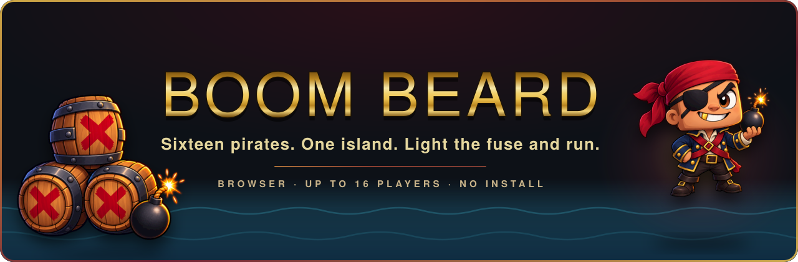
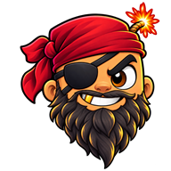

<p align="center">
  <a href="https://boombeard.co.za">
    
  </a>
</p>

<p align="center">
  <a href="https://boombeard.co.za"></a>
  
  
  <a href="LICENSE"></a>
</p>

<p align="center">
  <b>Sixteen pirates, one island, and a great many bombs.</b> Open the link, pick a name, you are
  in. No install, no launcher, no account.
  <br>
  In the line of <b>Bomberman</b>, <b>Game of Bombs</b> and <b>Crazy Arcade</b>.
</p>

<br>

##  How it goes

Ten minutes a round, five islands in rotation. Drop a bomb, get clear, be standing at the whistle.

| | |
|---|---|
| Move | <kbd>W</kbd> <kbd>A</kbd> <kbd>S</kbd> <kbd>D</kbd> or the arrows. Hold two for a diagonal |
| Bomb | <kbd>Space</kbd> or <kbd>K</kbd>, on the tile you are facing. Same key gets you back up |
| Dash | Double-tap a direction. Costs stamina, goes through people |
| Emote | <kbd>Shift</kbd> + a direction |
| Chat | <kbd>Enter</kbd> |
| Scoreboard | <kbd>Tab</kbd> — round and all-time |
| Back out | <kbd>Esc</kbd> |

Fire runs in a cross and stops at walls. It sets off any bomb it touches, and chains are where
rounds are decided. Your own fire kills you at exactly the speed everyone else's does. A death
costs you fifteen seconds, which is long enough to watch how the fight you just left turns out.

##  On the island

| | | |
|---|---|---|
|  | **Bombs and fire** | A cross, stopped by walls, handed on to any bomb it reaches. |
|  | **Powder kegs** | Rare barrels. Break one and it takes the neighbourhood with it. One a round, at least. |
|  | **Stamina** | Ten seconds of sprint, then you limp. Stopping to breathe is a real decision. |
|  | **Perks** | More bombs, longer fire, boots, a shield, stim, and rum — which saves you from everything except the tile the bomb was on, and steers like a shopping trolley. |
|  | **Ice** | Melts to a puddle when it is hit. Half pace, and you keep going after you let go. |
|  | **Gold** | The rarest thing on the floor. Worth nothing in the round, worth a lot on the board. |
|  | **Seagulls** | Scenery, until you catch one in a blast — then it pays. Once a round, two of them pick a player and settle it themselves. |
|  | **Kill streaks** | Double, triple, ultra, rampage, and an **ACE** for taking the whole island in one run. |

##  Medals

A medal is a podium finish. Handed out at the whistle, kept for good.

| | | |
|---|---|---|
|  | **Gold** | First |
|  | **Silver** | Second |
|  | **Bronze** | Third |

Coins are their own thing — picked up off the floor mid-round, counted next to the medals.

##  Score

Round score resets at the whistle. Lifetime score sits in one small file on the server and feeds
the all-time board, alongside kills, deaths, medals and coins.

| | |
|---|---|
| Kill | +100 |
| Gold coin | +400 |
| Survive the round | +50 |
| Perk | +5, or +15 once it is capped |
| Block | +2 |
| Suicide | &minus;25 |

##  Ranks

Lifetime score is your XP, so anything that scores also levels you. A good hour is about 12,000.
Level 1 takes a minute. Veteran takes about a hundred hours.

| Level | Rank | Lifetime score |
|---|---|---|
| 1 | Rookie | 200 |
| 5 | Rookie | 21,420 |
| 10 | Rookie | 160,324 |
| 11 | Been around the block | 211,447 |
| 16 | Pro | 627,708 |
| 20 | Veteran | 1,200,000 |

Levels carry on past Veteran. The rank does not.

##  Run your own island

One Node.js server, no database.

```bash
npm install
npm start            # http://localhost:8080, open two tabs
```

Settings go in an optional `config.ini` (copy `config.example.ini`); every one of them also works
as an environment variable.

| Setting | Default | |
|---|---|---|
| `port` | `8080` | Where the game is served |
| `max_players` | `16` | Seats on the island |
| `min_bots` | `6` | Bots held in the room while anyone is playing (`0` for none) |

Bots turn up the moment somebody does, so nobody plays alone, and they clear out when the island
empties. Public server: [docs/DEPLOY.md](docs/DEPLOY.md).

<details>
<summary><b>Host commands</b>, for whoever is running the room</summary>
<br>

The host is the longest-standing player, marked with a crown on the scoreboard. It passes on by
itself when they leave.

| | |
|---|---|
| `/restart` | Round from the top |
| `/map 0-4` | Change island |
| `/roundtime 0.1-60` | Round length in minutes, live |
| `/gamespeed 10-200` | Run the whole game fast or slow |
| `/bots N` | Number of bots (anyone can use this) |
| `/kick NAME` | Remove a player |

</details>

##  Under the hood

- Vanilla JavaScript in the browser, Node.js on the server. No framework, no build step, two
  runtime dependencies.
- WebTransport over QUIC where the network allows it, WebSocket where it does not. You are not
  meant to be able to tell which one you got.
- One deterministic simulation, shared by both sides. Your movement and every explosion are
  predicted locally and almost never corrected.
- Art and sound effects written in code. Four produced music tracks.
- 372 tests on Node's own runner, on every push.

| | |
|---|---|
| [Design](docs/DESIGN.md) | What this is for, and what it refuses to be |
| [Rules](docs/RULES.md) | Every rule and every number |
| [Netcode](docs/NETCODE.md) | Staying sharp on a bad connection |
| [Art and audio](docs/ART-AUDIO.md) | How the look and the sound are made |
| [Architecture](docs/ARCHITECTURE.md) · [Protocol](docs/PROTOCOL.md) | For developers |
| [Status](docs/STATUS.md) | Built, and next |

##  Credits

In the line of **Bomberman**, **Game of Bombs** and **Crazy Arcade**. None of their art is used —
everything here is original.

Code under the [MIT licence](LICENSE). The display typeface comes with its own, included beside it
in `public/assets/fonts/`.

<p align="center">
  <br>
  <sub>Made in 2026 by cobusvonwielligh. Stay frosty.</sub>
</p>
